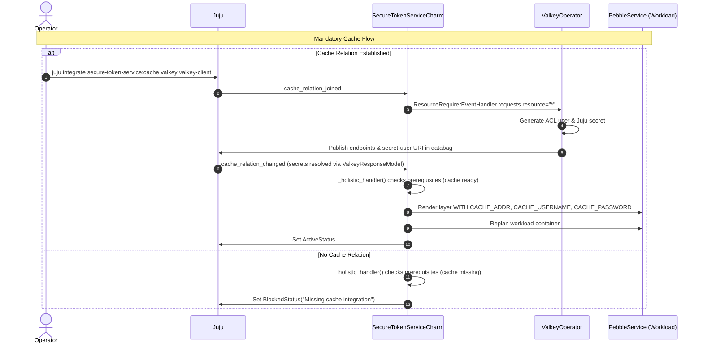

## Context

Currently, the Secure Token Service (STS) Operator relies on manual Juju configuration values (`cache_address`, `cache_username`, `cache_password`, and `cache_db`) to connect to Valkey/Redis for token and session storage. This requires operators to manually inspect Valkey databags/secrets and copy credentials during deployment.

The Charmed Valkey Operator provides a dedicated `valkey_client` (v1) interface powered by Canonical Data Platform's `dpcharmlibs-interfaces==1.2.2` (`ResourceRequirerEventHandler` / `ValkeyResponseModel`). This interface provides automated ACL credential creation, endpoint discovery, secret management, and lifecycle events tailored for Valkey/Redis key-value resources.

In production deployments, the cache integration is mandatory for session and token caching in STS. Therefore, the `cache` relation in the charm is modeled as **mandatory** (`optional: false`), and STS must enter `BlockedStatus` when the integration is absent.

## Goals / Non-Goals

**Goals:**
- Add `dpcharmlibs-interfaces==1.2.2` to runtime dependencies in `pyproject.toml`.
- Declare the mandatory `cache` relation endpoint (`interface: valkey_client`, `optional: false`, `limit: 1`) in `charmcraft.yaml`.
- Integrate `ResourceRequirerEventHandler` from `dpcharmlibs.interfaces` requesting global keyspace access (`RequirerCommonModel(resource="*")`) and typed responses via `ValkeyResponseModel`.
- Implement `CacheConfig` in `src/integrations.py` to extract Valkey credentials and map them to container environment variables (`CACHE_ADDR`, `CACHE_USERNAME`, `CACHE_PASSWORD`).
- Wire cache lifecycle events into the centralized `_holistic_handler` in `src/charm.py`.
- Handle `_check_prerequisites()`: enter `BlockedStatus("Missing cache integration")` if `cache` relation is missing; enter `WaitingStatus("Waiting for cache creation")` if the relation exists but credentials are not yet ready.
- Remove manual cache configuration options (`cache_address`, `cache_username`, `cache_password`, `cache_db`) from `charmcraft.yaml` and `src/configs.py`.
- Add unit and integration tests covering the mandatory cache integration lifecycle.

**Non-Goals:**
- Implementing Valkey cluster mode or multi-database partitioning inside STS (STS operates against a single database/keyspace index `0`).
- Managing TLS certificate verification inside `CacheConfig` beyond existing CA bundle logic.
- Supporting legacy manual configuration fallback alongside the relation interface.

## Architecture & Interaction



## Decisions

### D1 — Endpoint Name: `cache`, Interface: `valkey_client`, and `optional: false`
The relation endpoint in `charmcraft.yaml` is declared as:
```yaml
requires:
  cache:
    interface: valkey_client
    limit: 1
    optional: false
    description: Integration with Valkey/Redis for session and token caching.
```
- **Rationale**: `cache` accurately describes the functional role in STS (session caching and token store), while `valkey_client` is the standardized Canonical interface provided by `valkey-operator`. `optional: false` ensures STS deployments have a cache backend properly related and configured before becoming active.
- **Alternatives Considered**: 
  - Making cache optional (`optional: true`): Rejected because caching is required for production deployments and operational readiness of STS.

### D2 — Library: `ResourceRequirerEventHandler` via `dpcharmlibs-interfaces==1.2.2`
Adopt `dpcharmlibs.interfaces.ResourceRequirerEventHandler` with `ValkeyResponseModel` and `RequirerCommonModel(resource="*")`.
- **Rationale**: For the `valkey_client` (v1) interface provided by `valkey-operator`, `dpcharmlibs-interfaces` is the dedicated package providing typed `ValkeyResponseModel` parsing, resource/ACL scoping (`RequirerCommonModel`), and Juju Secrets resolution.
- **Alternatives Considered**:
  - Raw relation data manipulation: Rejected as `dpcharmlibs-interfaces` handles Juju Secrets lifecycle, databag events, and typed Pydantic models automatically.

### D3 — Keyspace Resource Scope (`resource="*"`)
Pass `requests=[RequirerCommonModel(resource="*")]` when initializing `ResourceRequirerEventHandler`.
- **Rationale**: `valkey-operator` configures Redis ACL rules based on the requested resource pattern. Because STS manages multiple session and token key patterns without a single rigid prefix, unrestricted access (`"*"`) ensures all STS operations are permitted by Valkey's ACL.
- **Alternatives Considered**:
  - Dedicated prefix (e.g. `"sts:*"`): Rejected as STS Go binary creates multiple top-level keys for session and token namespaces.

### D4 — Data Extraction via `CacheConfig` in `src/integrations.py`
Encapsulate relation data extraction into a dedicated frozen dataclass `CacheConfig` implementing `EnvVarConvertible`.
- **Properties**:
  - `endpoint`: First entry from `endpoints.split(",")[0]` (host:port).
  - `username`: Auto-generated ACL username from `ValkeyResponseModel`.
  - `password`: Auto-generated ACL password from `ValkeyResponseModel`.
- **Behavior**: Returns `CacheConfig.load(requirer)` with parsed credentials when relation data exists and is valid. Defaults `0` for cache database is handled natively by the workload binary.
- **Resilience**: `CacheConfig.load()` wraps `are_all_resources_created`, `build_model`, and field extraction in `try ... except (DataInterfacesError, ValidationError, SecretError, SecretsUnavailableError, ModelError, ValueError)` returning an empty `CacheConfig()` on error to guard against Juju secret latency or relation churn.

### D5 — Removal of Manual Juju Cache Config Options
Remove `cache_address`, `cache_username`, `cache_password`, and `cache_db` from `charmcraft.yaml` and `src/configs.py`.
- **Rationale**: Eliminates conflicting sources of truth and enforces automated credential exchange via Juju relations and secrets.

### D6 — Event Handling, Status Propagation & Holistic Reconciliation in `src/charm.py`
Observe relation events on `self.valkey_interface.on` (including `resource_created`, `endpoints_changed`, `read_only_endpoints_changed`, `authentication_updated`, `status_raised`, and `status_resolved`) and `self.on[CACHE_INTEGRATION_NAME].relation_broken`, delegating each to `_holistic_handler()`.
- `_check_prerequisites()` logic for cache:
  - If `not cache_integration_exists(self)`:
    - Return `BlockedStatus(f"Missing {CACHE_INTEGRATION_NAME} integration"), False`.
  - If `cache_integration_exists(self)`:
    - Inspect provider relation statuses via `self.valkey_interface.get_statuses(rel.id)`.
    - If any status is fatal (`rel_status.is_fatal` / `5xxx`): return `BlockedStatus(f"Cache error: {rel_status.message}"), False`.
    - If any status is transitory (`rel_status.is_transitory` / `4xxx`): return `WaitingStatus(f"Cache: {rel_status.message}"), False`.
    - If `not cache_config.endpoint`: return `WaitingStatus("Waiting for cache creation"), False`.

### D7 — Cache CA Certificate Path Assessment
Unlike PostgreSQL or HTTPS endpoints, the upstream `canonical/secure-token-service` Go binary connects to cache via `valkey-go` and only parses `CACHE_ADDR`, `CACHE_USERNAME`, `CACHE_PASSWORD`, and `CACHE_DB` from the environment.
- **Assessment**: The workload binary does not implement or accept TLS configuration, client certificates, or a CA certificate path for Valkey. Consequently, neither a `cache_ca_cert_path` configuration nor a certificate transfer link is needed or supported for the cache relation.

## Security, Performance, Observability & Scalability

- **Security**: Sensitive Valkey credentials are transmitted via Juju Secrets rather than unencrypted databags. Credentials are injected directly into the container environment via Pebble.
- **Performance**: STS connects directly to the primary Valkey write endpoint. Zero intermediate proxies are introduced.
- **Observability**: Clear status transitions (`BlockedStatus`, `WaitingStatus`, `MaintenanceStatus`, `ActiveStatus`) provide immediate operator visibility during integration.
- **Scalability**: When Valkey scales or fails over, updated endpoints trigger immediate reconciliation and Pebble service replan.
- **Database Migrations**: Valkey is an in-memory key-value cache; no relational SQL schema migrations are executed for the cache relation.

## Risks / Trade-offs

- **[Risk] Breaking change for deployments using manual config** → **Mitigation**: Document required relation in migration guide; Juju deployment bundles must relate `secure-token-service:cache` to `valkey:valkey-client`.
- **[Risk] External package dependency** → **Mitigation**: Pin `dpcharmlibs-interfaces==1.2.2` in `pyproject.toml`.
- **[Risk] Secret resolution latency** → **Mitigation**: `_check_prerequisites()` guards against unpopulated secret fields with `WaitingStatus`.

## Migration Plan

1. Add `dpcharmlibs-interfaces==1.2.2` to runtime dependencies in `pyproject.toml` and lock dependencies via `uv lock`.
2. Deploy or upgrade `secure-token-service-operator`.
3. Integrate STS with Valkey: `juju integrate secure-token-service:cache valkey:valkey-client`.
4. Workload reconciles and enters `ActiveStatus` once Valkey endpoints and credentials are provided (STS blocks on missing cache integration if not integrated).

## Open Questions

- None.
