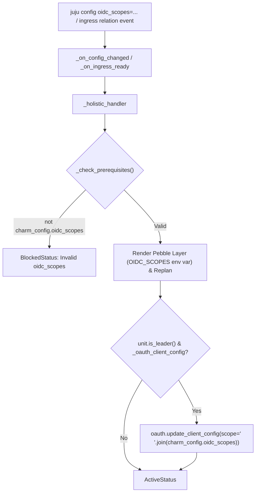

## Context

The `secure-token-service-operator` charm integrates with an OIDC provider (such as Charmed Hydra) via the `oauth` relation (`charms.hydra.v0.oauth`). Currently:
1. `src/constants.py` hardcodes `OAUTH_SCOPES = "openid email profile offline_access"`, which is passed into `OauthClientConfig(scope=OAUTH_SCOPES)` when registering the OAuth2 client with Hydra.
2. The `OIDC_SCOPES` environment variable is not emitted by `CharmConfig.to_env_vars()` (`src/configs.py`), leaving the `secure-token-service` workload binary to rely on its internal default rather than an explicit charm-managed value.
3. On `config_changed`, `src/charm.py` runs `self._holistic_handler(event)`, which updates the Pebble layer, but does not call `self.oauth.update_client_config(client_config=self._oauth_client_config)` (which is currently only called in `_on_ingress_ready`).

Operators need the ability to customize the OIDC scopes requested by STS (e.g., to add or remove scopes for specific deployments) while keeping the Hydra client registration (`OauthClientConfig.scope`) and the STS workload configuration (`OIDC_SCOPES`) synchronized.

## Goals / Non-Goals

**Goals:**
- Expose `oidc_scopes` in `charmcraft.yaml` with default `"openid email profile offline_access"` (space-separated).
- Parse `oidc_scopes` via `.split()` into `list[str]` and validate that it is non-empty in `_check_prerequisites()`.
- Emit `OIDC_SCOPES` as a comma-separated string (`",".join(self.oidc_scopes)`) in the workload Pebble environment via `CharmConfig.to_env_vars()`.
- Pass `" ".join(scopes)` to `OauthClientConfig` and propagate updates to the `oauth` relation on `config_changed` (as well as `_on_ingress_ready` and `relation_created`).
- Remove the hardcoded `OAUTH_SCOPES` constant from `src/constants.py`.

**Non-Goals:**
- Reading or adopting scopes from `OauthProviderConfig.scope` in the `oauth` provider databag.
- Database schema modifications (no database tables, indexes, or migrations are affected by OIDC scope configuration).
- Validating individual scope token names beyond non-empty string validation.

## Decisions

### 1. Source of Truth: Juju Config (`oidc_scopes`) vs `oauth` Provider Relation Databag
**Decision:** Configure OIDC scopes via a Juju config option `oidc_scopes` (defaulting to `"openid email profile offline_access"`) rather than reading `scope` from the `oauth` relation provider databag.

**Rationale & Alternatives Considered:**
- *Alternative: Read `scope` from `oauth` provider databag (`provider_info.scope`).* Rejected because:
  1. Hydra's provider databag advertises server-supported scopes (`"openid profile email phone"` by default), which omits `offline_access` and would break refresh token issuance for STS (`grant_types=["authorization_code", "refresh_token"]`).
  2. Requesting all provider-supported scopes violates the principle of least privilege (e.g., requesting `phone` when STS does not need it).
  3. `OAuthRequirer` writes `ClientConfig` to the requirer databag on `relation-created` before provider databag values are available, creating a lifecycle ordering dependency.
- *Chosen Approach:* `oidc_scopes` in Juju config lets the relying party (STS) declare the exact scopes it requires and keeps `OauthClientConfig.scope` and workload `OIDC_SCOPES` identical from a single source of truth.

### 2. Config Validation and Normalization
**Decision:** Parse `oidc_scopes` in `CharmConfig.oidc_scopes` (`src/configs.py`) using `str(self._config["oidc_scopes"]).split()`, returning a `list[str]` (or `[]` when empty/whitespace). In `_check_prerequisites()` (`src/charm.py`), if `not self.charm_config.oidc_scopes`, return `BlockedStatus("Invalid oidc_scopes: must be a non-empty space-separated list of scopes"), False`. Format `OIDC_SCOPES` as `",".join(self.oidc_scopes)` (for `kelseyhightower/envconfig` `[]string` parsing in the Go workload) and `OauthClientConfig.scope` as `" ".join(scopes)`.

**Rationale & Alternatives Considered:**
- *Alternative: Validate inside `CharmConfig` or only when `default_auth_provider == "oidc"`.* Performing prerequisite checks in `_check_prerequisites()` matches the existing charm pattern (alongside `default_auth_provider` and `ubuntu_one_realm` checks) and ensures the charm never writes an empty `scope` to the `oauth` relation or starts the workload with an invalid `OIDC_SCOPES` environment variable, regardless of which auth provider is default (since `/auth/login?provider=oidc` can still be invoked when `oauth` is integrated).

### 3. Synchronizing `OauthClientConfig` on `config_changed` and `ingress` events
**Decision:** Return `None` from `_oauth_client_config` when `self.charm_config.oidc_scopes` is empty, and use a helper `_update_oauth_client_config()` in both `_on_config_changed` and `_on_ingress_ready` that calls `self.oauth.update_client_config(client_config=client_config)` only when the unit is leader and `_oauth_client_config` is non-`None`.

**Rationale:**
Currently, `self.oauth.update_client_config()` is only called in `_on_ingress_ready()`. If an operator changes `juju config secure-token-service oidc_scopes="..."` after deployment, the leader unit must also update the `oauth` relation databag so Hydra updates the registered OAuth2 client's allowed scopes. Returning `None` from `_oauth_client_config` when `self.charm_config.oidc_scopes` is empty (`[]`) also prevents `OAuthRequirer` from writing an empty `scope` on `relation-created`, and calling `_update_oauth_client_config()` in both `_on_config_changed` and `_on_ingress_ready` ensures invalid config never overwrites relation data while keeping Hydra's client registration in sync with the workload's `OIDC_SCOPES` env var.

### 4. Security, Performance, Observability, Scalability, and Migration Considerations
- **Security:** Keeps requested OIDC scopes minimal and explicit (`openid email profile offline_access` by default), adhering to least privilege rather than requesting all upstream IdP scopes. No secrets are involved in scope strings.
- **Performance & Scalability:** `update_client_config` only mutates Juju application relation data on the leader unit; ops framework deduplicates unchanged relation databag writes, avoiding unnecessary hook churn across follower units or Hydra.
- **Observability:** Invalid (empty/whitespace) `oidc_scopes` immediately surfaces as `BlockedStatus` in `juju status`.
- **Database & Migration:** No database schema modifications are required. Existing deployments upgrading to this charm revision seamlessly retain `"openid email profile offline_access"` via the default value in `charmcraft.yaml`.

## Risks / Trade-offs

- **[Risk] Operator configures a scope not supported by the upstream OIDC provider** → **Mitigation:** Hydra or the upstream IdP will reject the scope during login or client update; operators can inspect logs and adjust `oidc_scopes` via `juju config`.
- **[Risk] `update_client_config` called when `oidc_scopes` is empty** → **Mitigation:** Gate `update_client_config` behind valid `oidc_scopes` (or run it only when `_check_prerequisites` passes / `self.charm_config.oidc_scopes` is non-empty) so invalid config never overwrites relation data.
